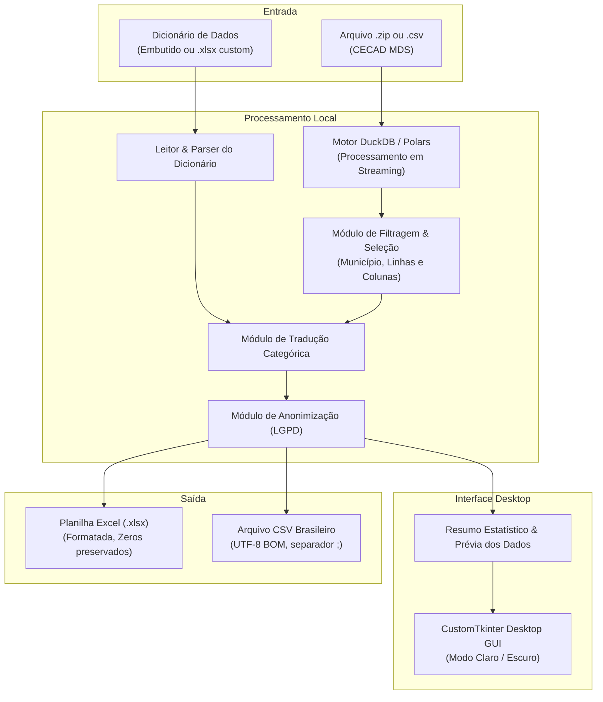

# Especificação Técnica e Funcional: AppLeituraCadastroUnico

**Versão do Documento:** 1.0  
**Data:** Outubro de 2026  
**Status:** Aprovado via Alinhamento de Requisitos (/grill-me)  
**Público-alvo:** Equipes Técnicas e de Gestão do SUAS / CadÚnico dos Municípios

---

## 1. Visão Geral do Produto

### 1.1 Contexto e Problema
A base de dados do Cadastro Único (CECAD) disponibilizada pelo Ministério do Desenvolvimento e Assistência Social, Família e Combate à Fome (MDS) é uma das ferramentas analíticas mais ricas para planejamento de políticas públicas locais. No entanto, sua utilização pelas equipes municipais enfrenta sérias barreiras:
1. **Dados Codificados:** Mais de uma centena de variáveis são entregues como códigos numéricos (ex: `cod_est_cadastral_fam = 3`, `fx_rfpc = 1`), exigindo constante consulta cruzada a um dicionário de dados em Excel com mais de 200 colunas.
2. **Volume e Formato de Dados:** Os arquivos estaduais ou macrorregionais chegam em arquivos compactados (`.zip`) com arquivos `.csv` que ultrapassam 1,5 GB e mais de 1,8 milhão de registros, superando a capacidade do Microsoft Excel (limite estrito de 1.048.576 linhas).
3. **Complexidade Técnica:** A grande maioria dos servidores municipais não possui formação em ciência de dados ou linguagens como Python/R, dependendo exclusivamente de planilhas.
4. **Formatação de Documentos Sensíveis:** Ao abrir o CSV padrão no Excel, zeros à esquerda de CPF, NIS e Códigos IBGE são descartados automaticamente ou convertidos em notação científica (ex: `3,2E+10`), inutilizando os dados para busca ativa.

### 1.2 Proposta de Valor
O **AppLeituraCadastroUnico** é um aplicativo desktop local, moderno e portátil (`.exe` único), que permite à equipe municipal importar arquivos `.csv` ou `.zip` do CECAD e obter automaticamente:
- **Tradução instantânea** de todos os códigos numéricos para seus textos descritivos equivalentes.
- **Cabeçalhos amigáveis** no lugar de nomes de colunas técnicos.
- **Reconhecimento inteligente** do arquivo (nível estadual vs. municipal e data de referência).
- **Filtros rápidos** por município, bairro, Bolsa Família, faixa de renda e atualização cadastral.
- **Perfis temáticos** para extrações focadas (ex: apenas benefícios, apenas habitação).
- **Exportação pronta para uso** em Excel (`.xlsx`) com formatação profissional (zeros à esquerda preservados como texto, cabeçalho congelado, filtros ativos) ou CSV compatível com o padrão brasileiro.
- **Modo LGPD / Compartilhamento** para gerar listas seguras para outros órgãos e secretarias.

---

## 2. Arquitetura da Solução



---

## 3. Especificação Funcional

### 3.1 Ingestão e Reconhecimento de Arquivos
- **Formatos Aceitos:**
  - Arquivo compactado `.zip` (lido diretamente na memória via streaming, sem exigir extração prévia em disco de arquivos de 1,5 GB).
  - Arquivo descompactado `.csv`.
- **Detecção Automática:**
  - **Data de Referência:** Identificada no nome do arquivo (ex: `tab_cad_07082026_32_20260911` $\rightarrow$ Base: Agosto/2026, Extração: 11/09/2026) e validada contra o campo `d.dat_atual_fam`.
  - **Escopo Geográfico:** Verifica se há múltiplos códigos de município (`d.cd_ibge`). Se houver apenas 1, identifica como "Base Municipal"; se houver múltiplos, identifica como "Base Estadual" e habilita a seleção de município.
- **Carregador de Dicionário:**
  - O aplicativo já vem com o dicionário oficial padrão embutido.
  - Botão opcional "Carregar Novo Dicionário (.xlsx)" para compatibilidade futura caso o MDS lance nova versão com alterações de códigos.

### 3.2 Escopo Geográfico e Filtragem por Município
- Se o arquivo for estadual:
  - Dropdown com busca por **Nome do Município** e **Código IBGE** (ex: `3204302 - Presidente Kennedy`, `3205309 - Vitória`).
  - Ao selecionar, apenas as linhas daquele município são processadas, reduzindo a base de ~1,8 milhão de linhas para uma faixa de 2.000 a 120.000 registros, perfeitamente compatível com o limite de 1.048.576 linhas do Excel.
- Se o arquivo já for municipal:
  - Exibe o nome do município reconhecido e bloqueia a necessidade de seleção geográfica manual.

### 3.3 Regras de Tradução e Cabeçalhos
- **Valores Categóricos:**
  - Cada célula cujo campo possui resposta no dicionário é substituída pelo rótulo descritivo.
  - Exemplo:
    - `d.cod_est_cadastral_fam = 3` $\rightarrow$ `Cadastrado`
    - `d.cod_forma_coleta_fam = 2` $\rightarrow$ `Com visita domiciliar`
    - `d.marc_pbf = 1` $\rightarrow$ `Sim` / `0` $\rightarrow$ `Não`
    - `d.cod_local_domic_fam = 1` $\rightarrow$ `Urbana` / `2` $\rightarrow$ `Rural`
  - Valores numéricos contínuos (ex: `vlr_renda_media_fam`, idades, datas) são preservados numericamente ou formatados em data padrão `DD/MM/AAAA`.
- **Cabeçalhos das Colunas:**
  - O usuário pode optar por:
    - **Nome Amigável** (padrão): Descrição do dicionário (ex: `Estado Cadastral da Família`).
    - **Código + Descrição**: Para técnicos que precisam da referência do MDS (ex: `[d.cod_est_cadastral_fam] Estado Cadastral da Família`).

### 3.4 Nível de Granularidade (Pessoa vs. Família)
A base original do CECAD possui granularidade no nível de **Pessoa** (múltiplas linhas por família). Na estrutura do MDS:
- Campos iniciados por **`d.`** referem-se aos atributos do **domicílio e da família** (ex: endereço, renda total, condições de moradia, marcação do PBF).
- Campos iniciados por **`p.`** referem-se aos atributos da **pessoa/indivíduo** (ex: nome, NIS, CPF, escolaridade, trabalho, parentesco).

O aplicativo oferecerá dois modos de visualização e exportação:
1. **Nível Pessoa (Original):** Cada linha representa um membro da família, contendo todos os dados demográficos individuais (`p.`) combinados com os dados do domicílio (`d.`).
2. **Nível Família (Consolidado):** Filtra apenas os registros onde `p.cod_parentesco_rf_pessoa = 1` (**Responsável Familiar / RF**). Gera uma tabela concisa de 1 linha por família com todos os dados do domicílio (`d.`) e onde o **NIS e CPF** apresentados são direta e expressamente os do **Responsável Familiar (RF)**.

### 3.5 Perfis Temáticos e Seleção de Colunas
Para evitar que o usuário municipal tenha que lidar com 160+ colunas no Excel, o aplicativo disponibiliza:
- **Exportar Todas as Colunas (Completo):** Mantém as colunas originais traduzidas.
- **Perfil 1: Visão Geral / Cadastro:** Identificação da família, Responsável Familiar (RF), endereço, bairro, data de cadastramento e data de atualização cadastral.
- **Perfil 2: Bolsa Família & Renda:** NIS e CPF do Responsável Familiar (no nível Família) ou de cada membro (no nível Pessoa), Marcação PBF, Renda Total, Renda Per Capita, Faixa de Renda, Quantidade de Meses Desatualizado e benefícios complementares (Auxílio Gás e BPC).
- **Perfil 3: Habitação & Vulnerabilidade:** Tipo de moradia, abastecimento de água, esgoto, coleta de lixo, material do piso e das paredes, energia elétrica.
- **Perfil 4: Pessoas, Educação & Trabalho:** Nome, idade, sexo, raça/cor, frequência escolar, grau de instrução, condição de trabalho e deficiência.
- **Seleção Livre:** Lista com caixas de seleção (checkboxes) e busca de campos para customização individual.

### 3.6 Filtros Rápidos de Linhas (Pré-Exportação)
O usuário pode combinar critérios simples na interface antes de gerar a planilha:
- **Bolsa Família:** `Todos` | `Apenas Beneficiários (Sim)` | `Apenas Não Beneficiários (Não)`
- **Situação Cadastral:** `Todos` | `Desatualizados (> 24 meses)` | `Atualizados (<= 24 meses)`
- **Faixa de Renda (RFPC):** `Todas` | `Extrema Pobreza (até R$ 89)` | `Pobreza (R$ 89 a R$ 178)` | `Baixa Renda` | `Acima de 1/2 S.M.`
- **Unidade Territorial / Bairro:** Seleção por CRAS ou bairro específico informado na base.

### 3.7 Modo LGPD / Compartilhamento
Quando ativado pelo operador:
- CPF: Mascarado no formato `***.***.123-**` ou removido.
- NIS: Mascarado no formato `***.*****.12-*`.
- Nome da Pessoa e Nome da Mãe: Ocultados ou substituídos por iniciais.
- Preserva intactos: Bairro, CEP, composição familiar, indicadores de renda e vulnerabilidade, permitindo análises epidemiológicas e intersetoriais seguras.

### 3.8 Resumo Estatístico e Prévia
- **Cards de Resumo:**
  - Total de Famílias no arquivo/filtro.
  - Total de Indivíduos (Pessoas).
  - Quantidade e % de Famílias com Bolsa Família.
  - Quantidade e % de Famílias com Cadastro Desatualizado.
  - Média da Renda Familiar Per Capita.
- **Tabela de Pré-visualização:**
  - Grid com os primeiros 50 registros traduzidos para inspeção imediata antes de disparar a gravação final do arquivo.

### 3.9 Exportação Formatada
- **Formato Excel (.xlsx):**
  - **Preservação de Zeros à Esquerda:** Colunas de CPF, NIS, Código IBGE e CEP são explicitamente tipadas como `Text` no arquivo XML do Excel, evitando truncamentos e conversão em notação científica.
  - **Usabilidade:** Primeira linha congelada (Freeze Panes), cabeçalho com cor de destaque e autofiltro ativado nativamente em todas as colunas.
- **Formato CSV:**
  - Codificação: `UTF-8 com BOM` (garante que acentuações como *Atenção*, *Não*, *São* abram perfeitamente com duplo clique no Excel brasileiro).
  - Delimitador: Ponto e vírgula (`;`).

---

## 4. Requisitos Não Funcionais e Tecnologias

| Aspecto | Especificação |
|---|---|
| **Linguagem Principal** | Python 3.12+ |
| **Interface Gráfica (GUI)** | `CustomTkinter` (interface moderna, cantos arredondados, alternância claro/escuro) |
| **Motor de Dados** | `DuckDB` + `Polars` / `PyArrow` (leitura em streaming, consumo de RAM < 300 MB mesmo em bases estaduais de 1,5 GB) |
| **Geração de Planilhas** | `xlsxwriter` / `openpyxl` com escrita em modo otimizado de streaming |
| **Empacotamento** | `PyInstaller` em executável único portátil (.exe), sem dependência de instalação de interpretador |
| **Compatibilidade de SO** | Windows 10 e Windows 11 (64-bit) |
| **Operação Offline** | 100% offline; nenhum dado transita para a internet, atendendo integralmente à LGPD e à política de sigilo do MDS |

---

## 5. Estrutura de Pastas do Projeto

```
AppLeituraCadastroUnico/
│
├── base/                                # Dados de teste e dicionário fornecidos
│   ├── dicionariocecad_marc_pbf.xlsx
│   └── tab_cad_07082026_32_20260911.zip
│
├── docs/                                # Documentação e especificações
│   └── ESPECIFICACAO_TECNICA.md
│
├── src/                                 # Código-fonte da aplicação
│   ├── app.py                           # Ponto de entrada da interface gráfica
│   ├── ui/                              # Telas e componentes visuais (CustomTkinter)
│   │   ├── main_window.py               # Janela principal e navegação
│   │   ├── components/                  # Cards, barra de progresso, tabela de prévia
│   │   └── dialogs/                     # Seletores de filtros, colunas e preferências
│   ├── core/                            # Regras de negócio e processamento de dados
│   │   ├── dictionary_parser.py         # Leitor e compilador de mapeamentos do dicionário
│   │   ├── file_inspector.py            # Reconhecimento de zip/csv, data e escopo municipal
│   │   ├── data_engine.py               # Motor DuckDB/Polars para filtragem e tradução
│   │   ├── exporter.py                  # Exportadores especializados (Excel formatado e CSV)
│   │   └── lgpd.py                      # Módulo de anonimização e mascaramento
│   └── assets/                          # Ícones e dicionário padrão embutido
│       └── dicionario_padrao.json
│
├── tests/                               # Testes automatizados unitários e de integração
│   ├── test_dictionary_parser.py
│   ├── test_file_inspector.py
│   └── test_translation_engine.py
│
├── requirements.txt                     # Dependências de desenvolvimento
├── build_exe.py                         # Script de automação do PyInstaller
└── README.md                            # Guia rápido de compilação e uso
```

---

## 6. Próximos Passos (Plano de Implementação)

1. **Fase 1: Motor do Dicionário e Leitura (`core/`)**
   - Construir o `dictionary_parser.py` para carregar o `dicionariocecad_marc_pbf.xlsx` e gerar o mapa estruturado de tradução (códigos $\rightarrow$ descrições).
   - Implementar o `file_inspector.py` para inspecionar `.zip`/`.csv`, detectar data de referência e lista de municípios disponíveis (`cd_ibge`).
2. **Fase 2: Motor de Processamento (`data_engine.py` e `exporter.py`)**
   - Configurar o DuckDB para executar o filtro de município diretamente no streaming do CSV compactado.
   - Aplicar a tradução vetorizada com base no dicionário compilado.
   - Criar exportador `.xlsx` com formatação de texto para CPF/NIS e cabeçalhos formatados.
3. **Fase 3: Interface Desktop (`ui/` com CustomTkinter)**
   - Construir tela de seleção de arquivo com arrastar-e-soltar (drag & drop).
   - Painel de configuração: seleção de município, perfis temáticos, filtros rápidos e botão LGPD.
   - Cards de resumo estatístico e tabela de pré-visualização.
   - Barra de progresso com cancelamento.
4. **Fase 4: Validação com a Base Real do ES e Empacotamento**
   - Testar o fluxo completo utilizando a base de teste de setembro/2026 (`tab_cad_07082026_32_20260911.zip`).
   - Gerar o executável autônomo com `PyInstaller` e validar a execução em ambiente sem Python instalado.
